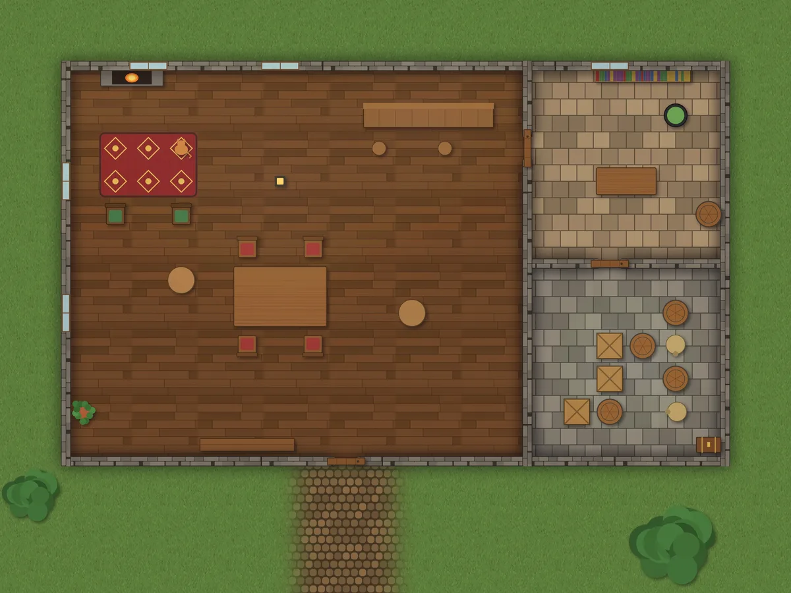
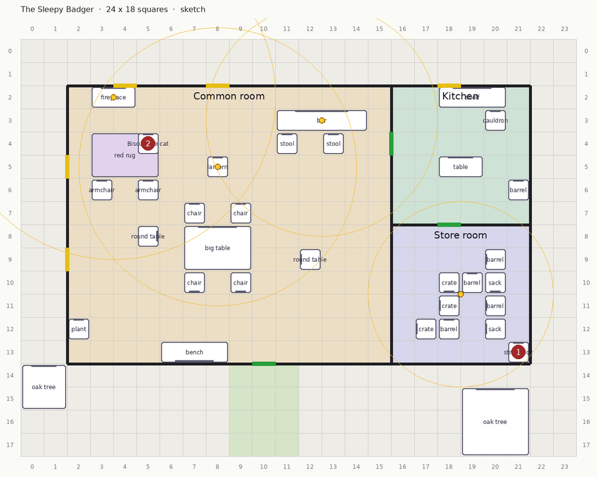
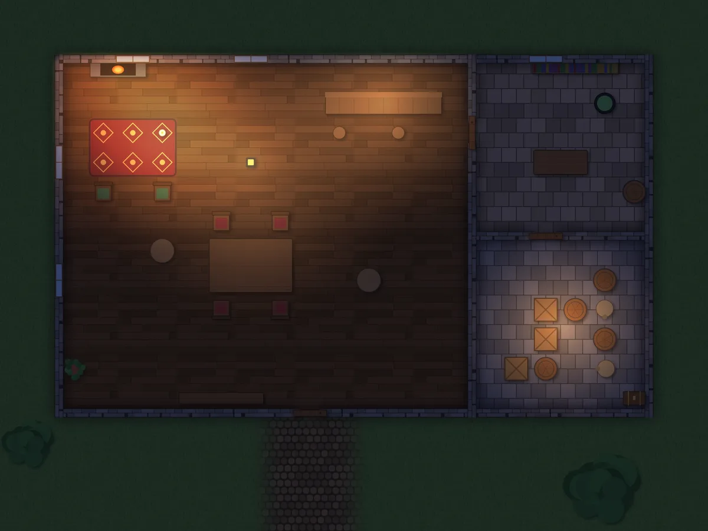
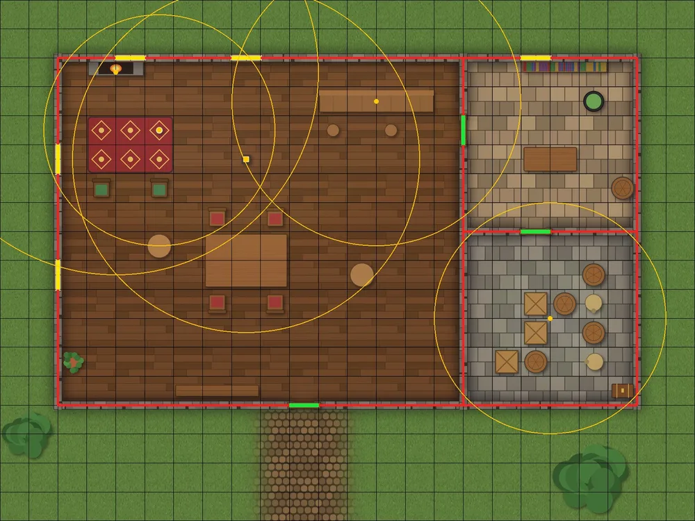

# MapWriter

MapWriter is a free, open-source (MIT) battlemap generator for Foundry VTT and other virtual tabletops. You describe a map in plain words, or ask an AI assistant such as Claude to describe it for you, and MapWriter paints it from the asset packs you already own and exports a `.dd2vtt` file with walls, doors and lights.

**Battlemaps from the asset packs you already own, described in plain words.**

You write a short scene file (or ask an AI assistant to write it for you) that says what rooms, doors and furniture you want. MapWriter finds matching art in your own asset folders, checks the layout, and paints a finished map in day and night versions. It also writes a Foundry VTT file with the walls, doors, windows and lights already placed.



*The example tavern, drawn with the free starter art that MapWriter makes for itself. With a real asset pack such as Forgotten Adventures the same scene file uses that pack's art.*

| Sketch for checking the layout | Night version | Wall, door and light check |
|---|---|---|
|  |  |  |

## What it does

- **Reads any asset folder.** It indexes Forgotten Adventures, 2-Minute Tabletop, or your own art by reading file and folder names (`Table_Round_Wood_Ashen_A2_2x2.webp` is a round ash-wood table, 2 by 2 squares).
- **Matches words to art.** Ask for `counter` and it finds a bar; ask for `big table` and it prefers a large one. Synonyms, sizes and your own tag fixes all count.
- **Checks your layout.** It warns about props with no matching art, furniture that overlaps, doors that aren't on a wall and rooms nobody can get into.
- **Paints the map.** Floors are tiled, walls are painted along their lines with doors and windows cut in, and furniture gets soft shadows. Lighting is baked in two versions: day (cosy and bright) and night (dim, with light pools). Candles, lanterns and fireplaces light themselves.
- **Exports for play.** You get a plain `.webp` per version, a labelled GM key, a check image, and a Universal VTT `.dd2vtt` for Foundry's Universal Battlemap Importer.

It never copies, uploads or bundles anyone's art. It reads your packs where they are.

## Install

Python 3.10 or newer.

```bash
pip install git+https://github.com/RLworkaccount/mapwriter
```

## Quick start

```bash
# 1. Draw the free starter pack, or skip this and use your own packs
mapwriter starter-pack starter

# 2. Index your asset folders (list your favourite pack first: it wins ties)
mapwriter index "path/to/FA_Assets" starter -o mapwriter-index.json

# 3. Check, sketch and paint a scene
mapwriter check examples/tavern.yaml
mapwriter sketch examples/tavern.yaml -o out
mapwriter render examples/tavern.yaml -o out
```

`render` writes these files to `out/`:

| File | What it is |
|---|---|
| `the-sleepy-badger-day.webp`, `-night.webp` | The finished maps, no labels |
| `the-sleepy-badger-day.dd2vtt`, `-night.dd2vtt` | Foundry import files with walls, doors, windows and lights |
| `the-sleepy-badger-key.jpg` | GM copy with room names and numbered notes |
| `the-sleepy-badger-check.jpg` | Walls red, doors green, windows yellow, arches blue, light ranges |
| `the-sleepy-badger-sketch.png` | Block plan with grid numbers |

Find art by words with `mapwriter search "round table"` or `mapwriter search planks -k floor`.

## A scene file

Scene files are YAML, measured in 5 ft grid squares. `x` runs right and `y` runs down from the top-left corner.

```yaml
name: Pelbury's shop
grid: { width: 14, height: 10 }
ground: cobblestone
rooms:
  - name: Shop
    box: [1, 1, 13, 9]
    floor: walnut wood planks
    doors:   [{ wall: south, at: 6 }]
    windows: [{ wall: south, at: [3, 10] }]
props:
  - { want: counter, at: [4, 3], size: [4, 1] }
  - { want: bookshelf, in: Shop, along: north, count: 3 }
  - { want: barrel, in: Shop, count: 2 }
  - { want: chest, at: [11, 7], label: strongbox }
lights:
  - { at: [7, 4], radius: 6, colour: warm }
notes:
  - { at: [11.5, 7.5], text: "Pelbury's strongbox. Locked; the key is under the counter." }
```

The full format is in [docs/scene-format.md](docs/scene-format.md).

## Describing a map to an AI

MapWriter is built so an assistant such as Claude can write the scene file from a plain description, run `check` and `sketch`, read the warnings, and fix the layout before painting. Copy this prompt, paste it into Claude (or another assistant that can run commands), and replace the last line with your map:

```text
I use MapWriter (https://github.com/RLworkaccount/mapwriter) to make battlemaps.
Please install it if needed (pip install git+https://github.com/RLworkaccount/mapwriter),
then write a scene file for the map below, following docs/scene-format.md in that repo.

Rules:
- Grid squares are 5 ft. Make rooms a believable size: a bedroom is about 3 x 4 squares,
  a tavern common room 10 x 8 or more.
- Every walled room needs a door or arch, and doors should not open straight into furniture.
- Put furniture where people would use it: chairs around tables, beds against walls,
  shelves along walls (along:).
- Use want: words that are likely to match asset file names. Run mapwriter search "words"
  to see what my packs have.
- Add notes: for anything the GM needs to know, and label: for important props.
- Run mapwriter check and mapwriter sketch, fix anything they report, and show me the
  sketch before running mapwriter render.

The map: (describe it here)
```

[docs/describe-with-ai.md](docs/describe-with-ai.md) explains the loop and has more tips.

## Asset packs

See [docs/asset-packs.md](docs/asset-packs.md) for how packs are read, how to add a `mapwriter-pack.yaml` to a pack folder, and how to fix tags with a `tags.yaml`.

**Licences:** asset packs keep their own licences. Most allow maps for your own games but not sharing the raw art. MapWriter never redistributes packs, and you shouldn't commit them to a repository. The starter art drawn by `mapwriter starter-pack` is MIT licensed with this project.

## Roadmap

v0.1 covers indoor scenes. Next up: outdoor areas and scatter (v0.2), describe and edit-in-words commands (v0.3), picture-based tagging for any pack (v0.4), whole-place generators (v0.5), full Foundry scenes (v0.6), and a web editor plus an MCP server (v0.7). Details in [ROADMAP.md](ROADMAP.md).

## Licence

MIT. See [LICENSE](LICENSE).
